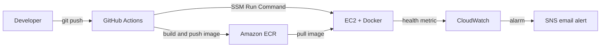

# AWS CI/CD Pipeline: Docker, ECR, Terraform

Automated deployment of a Flask app to AWS EC2. A push to `main` tests the app, builds a Docker image, pushes it to Amazon ECR, and deploys it to EC2 with no manual steps. Includes one-click rollback, infrastructure as code, and health monitoring with email alerts.

## Architecture



## Tech stack

| Area | Tools |
|---|---|
| App | Python, Flask, Gunicorn |
| Containers | Docker, Amazon ECR |
| CI/CD | GitHub Actions |
| Compute | Amazon EC2 (Ubuntu) |
| Security | IAM roles and instance profile, AWS Systems Manager (no SSH needed, no keys on the server) |
| Infrastructure as code | Terraform |
| Monitoring | CloudWatch custom metric, CloudWatch alarm, SNS email |

## Project structure

```
.
├── app/
│   ├── app.py              # Flask app with / and /health endpoints
│   ├── requirements.txt
│   ├── Dockerfile
│   └── .dockerignore
├── terraform/
│   └── main.tf             # EC2, security group, IAM role, ECR repo
├── scripts/
│   └── healthcheck.sh      # Publishes the HealthStatus metric to CloudWatch
├── .github/workflows/
│   ├── deploy.yml          # CI/CD on every push to main
│   └── rollback.yml        # Manual rollback to any image tag
└── README.md
```

## How the pipeline works

On every push to `main`, `deploy.yml` runs these steps:

1. **Test:** starts the app and checks that `/health` returns HTTP 200. A failing test stops the pipeline before anything is built.
2. **Authenticate:** logs in to AWS and Amazon ECR.
3. **Build and push:** builds the Docker image and pushes it to ECR with two tags: the commit SHA (for traceability and rollback) and `latest`.
4. **Deploy:** sends a command through AWS Systems Manager to the EC2 instance. The instance pulls the new image, replaces the running container, and verifies `/health`.

## Rollback

Every image is tagged with its commit SHA, so any previous version can be redeployed:

1. GitHub, then **Actions**, then **Rollback**, then **Run workflow**.
2. Enter the ECR image tag (a commit SHA) to deploy.

## Monitoring

A cron job on the server runs `scripts/healthcheck.sh` every minute and publishes `FlaskApp/HealthStatus` (1 = healthy, 0 = down) to CloudWatch. A CloudWatch alarm sends an email through SNS when the metric drops below 1 for two consecutive minutes. Missing data is treated as breaching, so a dead server also triggers the alarm.

## Infrastructure as code

```bash
cd terraform
terraform init
terraform plan
terraform apply     # creates ECR repo, security group, IAM role, instance profile, EC2 instance
terraform destroy   # removes everything
```

Terraform state files are never committed (see `.gitignore`).

## Required GitHub secrets

| Secret | Purpose |
|---|---|
| `AWS_ACCESS_KEY_ID` | Deployer IAM user (ECR push and SSM send-command) |
| `AWS_SECRET_ACCESS_KEY` | Deployer IAM user |
| `EC2_INSTANCE_ID` | Target instance, format `i-xxxxxxxxxxxxxxxxx` |

## Run the app locally

```bash
cd app
docker build -t flask-cicd-app .
docker run -p 5000:5000 flask-cicd-app
curl http://localhost:5000/health
```

## Screenshots

<!-- Add these: green pipeline run, live app in the browser, ECR repo with tags, CloudWatch alarm in "In alarm" state, alert email -->

## Challenges and what I learned

- **Failed deploy step:** the pipeline built and pushed the image fine but the deploy step failed. The error showed the `EC2_INSTANCE_ID` secret was not a valid instance ID. Reading the exact error message found the cause quickly: a configuration problem, not a code problem.
- **Docker layer caching:** a rebuild said "Using cache" even for the app code, which showed the file had not actually changed. Tags are labels, not proof of new code.
- **IAM roles vs access keys:** the server accesses ECR and SSM through an instance role, so no long-lived credentials are stored on it.
- **Credential hygiene:** secrets must never appear in terminals, screenshots, or commits. Keys that were exposed were rotated immediately.

## Possible improvements

- HTTPS through an Application Load Balancer and a domain
- Blue/green deployment for zero downtime
- Replace the deployer access keys with GitHub OIDC and a short-lived role
- Remote Terraform state in S3 with locking
-
